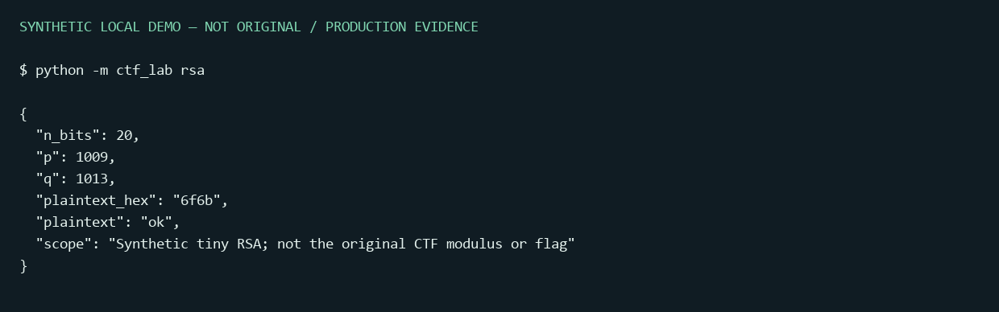

# Cyber CTF Write-ups

Academic investigations, honest outcomes and safe offline reconstructions by **Alef Kaue Santos Nunes**.
[Português](README.pt-BR.md) · [Evidence policy](docs/evidence-policy.md)

## Competition result

**3rd place overall in the CTF competition at Faculdade SENAI São Caetano do Sul**, as reported
by the participant. The competition included networking, cryptography, web security, OSINT and
technical investigation. The two academic reports substantiate technical activities, **not the ranking**.
No certificate, cash prize, national placement or additional award is claimed.

The source reports are dated September 25, 2026 and were co-authored in a pair. Public write-ups
are original, sanitized summaries of that collective work. The code here was reconstructed for
teaching with AI assistance; it is not represented as a verbatim archive of competition scripts.

| Case | Documented outcome | Reproduction here |
|---|---|---|
| [Star Wars](writeups/star-wars.md) | Final flag obtained in the academic challenge | Bounded tiny-RSA example with different parameters and plaintext |
| [Among Us](writeups/among-us.md) | Partial progress; final flag **not obtained** | Log correlation, unverified JWT inspection and synthetic LSB samples |



## Try it locally

Python 3.11+, no external runtime dependencies, no web server required:

```console
python -m ctf_lab rsa
python -m ctf_lab forensics
python -m ctf_lab jwt
python -m ctf_lab lsb
python -m unittest discover -s tests -v
```

Optional package installation: `python -m pip install .`, then `ctf-lab rsa`.
The RSA demo recovers `ok` using a deliberately tiny modulus. The forensic demo explicitly returns
`partial`, `trace_anchor: null` and `final_flag_obtained: false`. A decoded JWT is never marked verified.

## What this demonstrates

- Following a chain of evidence instead of reporting isolated tool output as a complete exploit.
- Distinguishing public RSA parameters from a genuinely unsafe modulus and weak authentication.
- Treating session state, timestamps, signatures and log provenance as separate investigation problems.
- Documenting failed hypotheses and avoiding a success claim when the final condition was not met.
- Reconstructing an explanation that another student can execute without touching third-party systems.

This repository contains **no original PDFs, infrastructure addresses, session cookies, private
keys, recovered credentials or original flags**. Screenshots are rendered outputs of the synthetic
demos, not captures of the academic environment. MIT covers original code and public documentation;
it does not license the original challenge, third-party assets or private reports.

## Repository map

`ctf_lab/`: standard-library teaching code · `writeups/`: separate investigations · `tests/`: executable
checks · `docs/`: provenance, diagrams and example outputs. CI runs tests on Linux and Windows.

## References for further study

- [RFC 8017 — PKCS #1](https://www.rfc-editor.org/rfc/rfc8017)
- [RFC 8725 — JWT best current practices](https://www.rfc-editor.org/rfc/rfc8725)
- [OWASP Logging Cheat Sheet](https://cheatsheetseries.owasp.org/cheatsheets/Logging_Cheat_Sheet.html)

The project is an academic/personal portfolio artifact, not professional penetration-testing experience.
