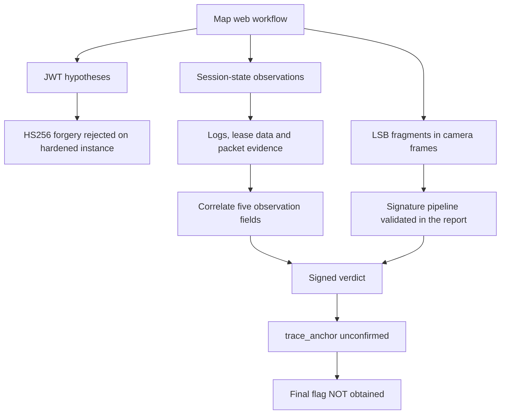

# Among Us — partial investigation, final flag not recovered

**Outcome:** investigation progressed, but the final `trace_anchor` condition was not confirmed.
The final flag was **not obtained**. This is not presented as a completed exploit.

## Separate challenge design from observed behavior

The source report describes a proposed JWT `kid`/algorithm-confusion route. In the instance actually
investigated, RS256-only validation rejected HS256 attempts. Recovering a **public** verification
modulus from signatures did not produce a signing key and did not enable JWT forgery.

The report records progress through reuse of existing session state, acquisition of investigation
artifacts, camera-frame LSB extraction and a valid RSA-PSS submission pipeline. Those original
cookies, session identifiers, cryptographic material and payloads are deliberately absent here.

## Evidence, progress and failed hypotheses

| Area | Reported result | What must not be claimed |
|---|---|---|
| JWT algorithm/kid investigation | Forgery attempts rejected in the live instance | Successful privilege escalation by JWT forgery |
| Sessions | Reused state allowed access to intermediate artifacts | General ability to forge arbitrary Flask sessions |
| Logs and forensic sources | Access events, task records, badge/biometric data and DHCP/DNS information correlated | Authenticated attribution in a real incident |
| LSB / cryptography | Signing material reconstructed from challenge fragments; RSA-PSS pipeline validated | Breaking production RSA-2048 |
| Deserialization | Tested restrictions did not yield RCE | Arbitrary execution via pickle |
| Signed verdict | Cryptographic verification passed, but semantic corroboration failed | Completed challenge or final flag |

Five observation fields were reconstructed in addition to the subject identity, according to the
report. The remaining derivation rule was not established. The source proposes that unavailable
server information caused the block; that is the authors' explanation, **not a proof that no other
solution existed**. An honest write-up preserves that uncertainty.

## Safe local reconstructions

1. `python -m ctf_lab jwt`: decode only synthetic header/claim structure; never asserts signature validity.
2. `python -m ctf_lab lsb`: extract a synthetic message from generated channel bytes. No private key or original frame.
3. `python -m ctf_lab forensics`: sort supplied synthetic events and flag transitions outside a supplied adjacency model.

The forensic result stays `partial` with `trace_anchor: null` and `final_flag_obtained: false`.
There is no invented solver for the unresolved field, no original brute-force kit and no target contact.

## Lessons

Validate signature format independently from payload correctness. Distinguish a signature failure
from semantic rejection. Recompute conclusions when a challenge rotates data by session. Preserve
failed hypotheses, clock assumptions and missing evidence. Do not treat a suspicious transition as
proof without considering absent logs, model quality and collection errors.

The additional DNS investigation repository applies this evidence-first approach to synthetic,
time-correlated DNS/DHCP exports rather than reimplementing a live challenge exploit.
