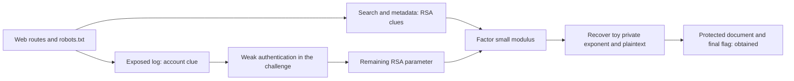

# Star Wars — completed academic investigation

**Outcome:** final flag obtained, according to the co-authored academic report.
**Publication scope:** sanitized explanation; original target, identifiers, secrets and flag removed.
**Role:** academic work in a pair; no claim of sole implementation or commercial testing.

## Question and evidence chain

The web challenge hid an application workflow behind themed pages. Reconnaissance exposed
an overlooked log route, which supplied a valid account identifier. Other pages contained
cryptographic clues. Weak password protection allowed entry to the area exposing the remaining
RSA parameter. The report describes a module of only **72 bits**, making factorization feasible.

This was a chain, not evidence that merely seeing a public key defeats RSA. Public `n` and `e`
are normally public. The critical cryptographic issue was inadequate key size; hiding public
parameters is not the solution. The report's broader recommendation to conceal RSA parameters
should not be interpreted as a substitute for sound key generation and standardized encoding.

## Reproduce the principle, not the target

`python -m ctf_lab rsa` uses **different, synthetic** primes 1009 and 1013 and plaintext `ok`.
The small module is factored by bounded trial division. Given distinct primes, the demo computes
`phi = (p-1)*(q-1)`, obtains `d = e^-1 mod phi`, then evaluates `m = c^d mod n`.
It rejects large moduli and is not a tool for attacking production RSA.

The demonstration uses textbook RSA strictly to expose the mathematics. It is not production
encryption, does not implement OAEP, and must not be reused to protect data.

## What is supported by the source report

| Observation | Interpretation |
|---|---|
| Hidden route mentioned in robots.txt | Discoverability, not access control |
| Account information in application logs | Information disclosure aiding further investigation |
| Successful weak-password path | Authentication weakness within the authorized scenario |
| Tiny RSA modulus and documented factorization | Cryptographic weakness in this challenge |
| Protected document recovered with final flag | Completed challenge, not proof of attacking unrelated systems |

The report describes curl/HTTP investigation, a dictionary-based authentication attempt, Python
number-theory work and technical documentation. This public reconstruction does not include the
dictionary attack, credentials, original requests or any live endpoint.

## Defensive lessons

Use established cryptographic libraries and current key-generation guidance. Apply suitable
authentication controls and rate limiting. Keep sensitive logs behind authorization. Check actual
authorization on each route rather than relying on unlinked pages. Document each link in a chain
so that a reviewer can distinguish an observation from an inference.

## Limitations

The original PDFs are private academic evidence and are not redistributed. This reconstruction
was not rerun against the original server. The screenshot in the README is a synthetic local run.
The competition ranking is participant-reported and independent of this technical outcome.
